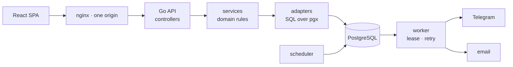

<p align="center">
  <a href="https://github.com/GoatWhistle/GoatWhistle">
    <picture>
      <source media="(prefers-color-scheme: dark)" srcset="docs/brand/wordmark-dark.svg"/>
      
    </picture>
  </a>
</p>

<p align="center">
  <strong>Every hackathon you are in, on one timeline.</strong><br/>
  Assignments, stages, deadlines and reminders in one place, so a registration
  window never closes while you were looking the other way.
</p>

<p align="center">
  <a href="#what-it-does">What it does</a>
  &nbsp;·&nbsp;
  <a href="#how-it-works">How it works</a>
  &nbsp;·&nbsp;
  <a href="#running-it">Running it</a>
  &nbsp;·&nbsp;
  <a href="#how-it-is-built">How it is built</a>
</p>

<p align="center">
  
  
  
  
  
</p>

> **Timeline never checks the external registration site.** A registration status is
> the participant's own report, or a state an administrator set — never a confirmed
> fact. The interface says so in as many words: "you marked it", not "confirmed".
> Nothing in the product pretends otherwise, and nothing should be added that does.

## What it does

An administrator creates an event, assigns participants and configures reminders.
A participant sees what they are assigned to, and marks for themselves that they
have registered. Reminders go out over Telegram or email.

<p align="center">
  <br/>
  <sub>The participant's event card. The badge reads <b>You marked it</b>, and the line under the
  form repeats why: the system does not check the external site.</sub>
</p>

Participants also form standing teams and enter an event with a lineup drawn from
one; each keeps a private layer of tasks, notes, submissions, an outcome and a
retrospective against every event they took part in.

<table>
<tr>
<td width="50%">

**Catalog**


Every event, as tiles or as a sortable table with the columns you pick. Filters,
CSV export, and a tick on the ones you are in.

</td>
<td width="50%">

**Schedule**


Your assignments over a week, month, quarter, year, or the whole timeline at once.
Each event keeps one colour so a crowded month still reads.

</td>
</tr>
<tr>
<td width="50%">

**Stages**


Applications, selection, build, checkpoint, submission, demo, results. A stage may
sit outside the event period — that is allowed, and only warns.

</td>
<td width="50%">

**Registration statuses**


Who reported, who did not, and who set it: the source column separates the
participant from an administrator from the system.

</td>
</tr>
</table>

## How it works

1. **Create** — an administrator adds an event: period, format, tracks and prizes,
   team size, and the stages it runs through.
2. **Assign** — participants are added in a batch, each with a team role. Every
   item is its own transaction, so a partial failure still reports per row.
3. **Set the deadline** — a registration carries the organiser's link and a
   deadline, which may never fall after the event ends.
4. **Schedule reminders** — up to ten rules per registration, each an offset before
   the deadline. The scheduler turns them into notifications.
5. **Report** — the participant opens the organiser's form, registers there, and
   marks it here. A bulk status change is limited to `TODO` and `NOT_REQUIRED`, so
   no administrator declares a room full of people registered in one click.
6. **Deliver** — the worker takes notifications under a lease and sends them to
   Telegram or email.



The API and the SPA are served from one origin, so the session cookie needs no
CORS and no `SameSite=None`. The scheduler and the worker are one separate process
beside the API, reading the same database.

## Running it

Everything runs in containers: Go, Node and PostgreSQL are not needed on the
machine, Docker is enough.

```bash
make dev
```

The application comes up on `http://localhost:5173`, the API on
`http://localhost:8080`, and Swagger UI on `/docs/`. Use `make docker-up` instead
for the production build behind nginx, and `make help` for everything else.

No account is created automatically — create the first administrator with the
backend CLI, then sign in with it:

```bash
docker compose -f deploy/docker-compose.yml -f deploy/docker-compose.dev.yml \
  run --rm --no-deps backend go run ./cmd/timeline admin create \
  --email you@example.com --password 'a-long-password' --name 'Your Name'
```

Configuration comes only from environment variables;
[`.env.example`](.env.example) is the full list, and `make docker-up` creates
`.env` from it. **Two defaults deliberately turn protection off so that
development on `http://localhost` needs no setup, and both must change on
deployment:** `COOKIE_SECURE=false` lets session cookies travel over plain HTTP,
and an empty `METRICS_TOKEN` leaves `/metrics` open to anyone who can reach the
port.

Before a change counts as done, `make verify` has to pass — the contract, types,
linters and tests for both parts.

## How it is built

A modular monolith in Go behind a React SPA, with a separate worker process for
delivery.

```text
backend/       Go: cmd, internal/{config,models,services,adapters,controllers,cli}, migrations
frontend/      React + TypeScript + Vite, Tailwind + shadcn/ui, TanStack Query, react-router
deploy/        Dockerfiles, nginx.conf, docker-compose.yml (+ .dev.yml)
docs/          The generated OpenAPI contract, ratchet baselines and these illustrations
scripts/       Ratchet checks, called from the Makefile
```

Inside the backend the layers are strict: `controllers` know about HTTP,
`services` hold domain rules and transaction boundaries, `adapters/repositories`
is SQL over pgx, and `models` is domain types and errors. A controller never
reaches into a repository directly. The frontend is organised by domain —
`src/entities` for the things themselves, `src/features` for what is done with
them — with shared code in `src/shared`, tokens in `src/styles`, and the shell and
routes in `src/app`.

The API contract lives in [`docs/swagger.yaml`](docs/swagger.yaml), generated from
annotations beside the controllers and never edited by hand. It is written before
the implementation, so both halves proceed from one description.

Several rules are enforced by machine rather than by review: a 250-line limit per
file and a file-count limit per package, both as ratchets over a recorded baseline
that only moves down; no import cycles, counting test imports too; no Cyrillic
outside the localisation dictionaries; and images only under `screenshots/`,
`frontend/public`, `frontend/src/assets` or `docs/`.
