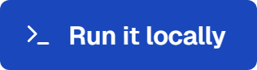
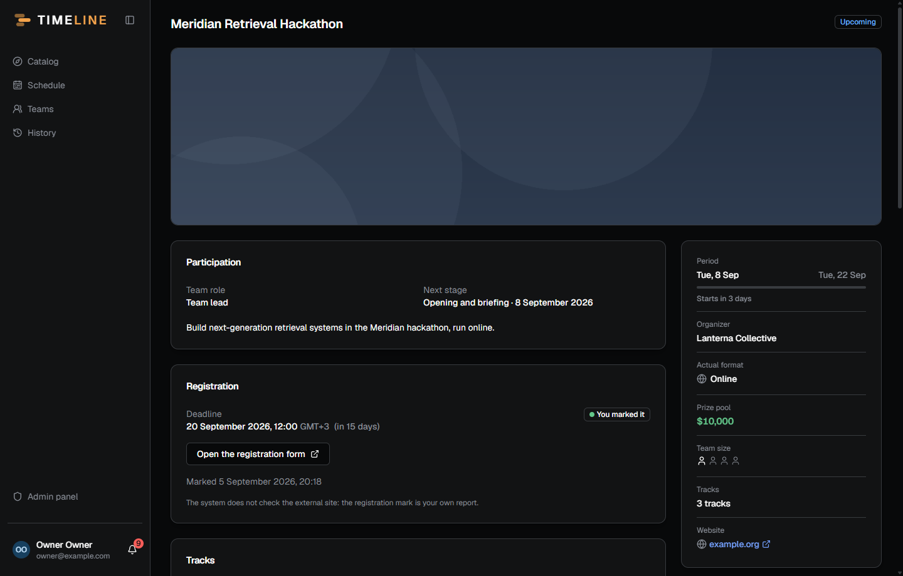
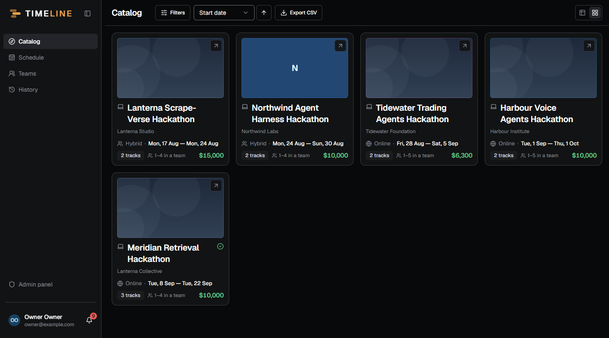
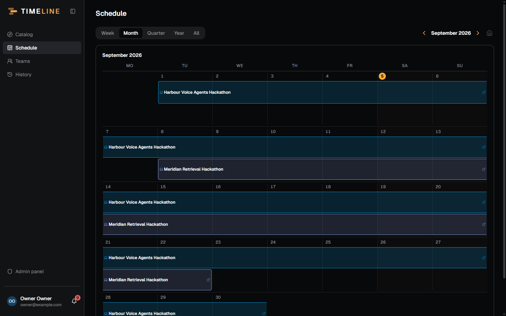
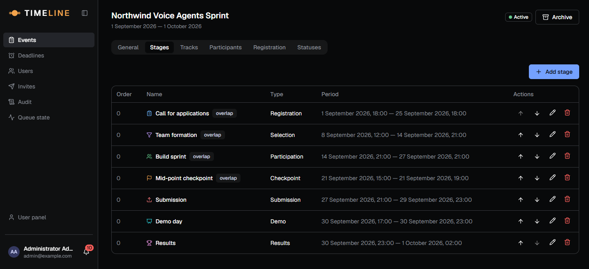
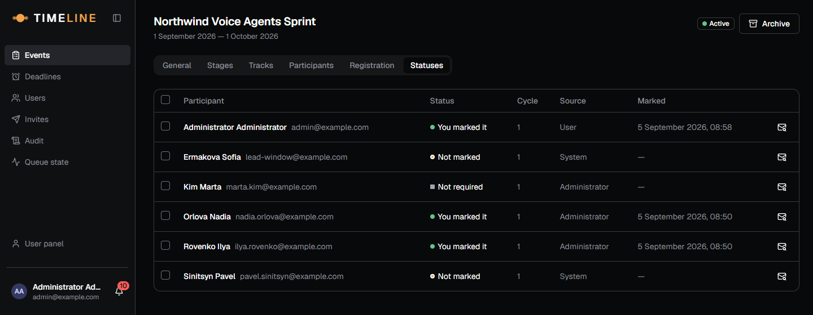
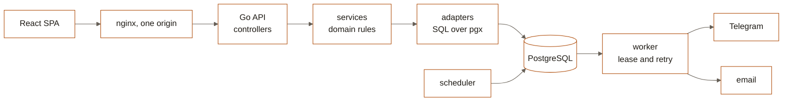

<p align="center">
  <picture>
    <source media="(prefers-color-scheme: dark)" srcset="docs/readme/banner.dark.png">
    
  </picture>
</p>

<p align="center">
  For people who take part in many hackathons and the administrators who line them up:
  assignments, stages, deadlines and reminders in one place, so a registration window
  never closes while you were looking the other way.
</p>

<p align="center">
  <!-- readme:buttons -->
  <a href="#running-it"><picture><source media="(prefers-color-scheme: dark)" srcset="docs/readme/cta-run.dark.png"></picture></a>
  <a href="docs/swagger.yaml"><picture><source media="(prefers-color-scheme: dark)" srcset="docs/readme/cta-contract.dark.png"></picture></a>
  <!-- /readme:buttons -->
</p>

<p align="center">
  <!-- readme:status -->
  <a href="#the-rule"><picture><source media="(prefers-color-scheme: dark)" srcset="docs/readme/badge-status-1.dark.png"></picture></a>
  <a href="#how-it-works"><picture><source media="(prefers-color-scheme: dark)" srcset="docs/readme/badge-status-2.dark.png"></picture></a>
  <br>
  <a href="#limitations"><picture><source media="(prefers-color-scheme: dark)" srcset="docs/readme/badge-status-3.dark.png"></picture></a>
  <picture><source media="(prefers-color-scheme: dark)" srcset="docs/readme/badge-status-4.dark.png"></picture>
  <a href="LICENSE"><picture><source media="(prefers-color-scheme: dark)" srcset="docs/readme/badge-status-5.dark.png"></picture></a>
  <!-- /readme:status -->
</p>

<p align="center">
  <!-- readme:stack -->
  <picture><source media="(prefers-color-scheme: dark)" srcset="docs/readme/badge-stack-1.dark.png"></picture>
  <picture><source media="(prefers-color-scheme: dark)" srcset="docs/readme/badge-stack-2.dark.png"></picture>
  <br>
  <picture><source media="(prefers-color-scheme: dark)" srcset="docs/readme/badge-stack-3.dark.png"></picture>
  <picture><source media="(prefers-color-scheme: dark)" srcset="docs/readme/badge-stack-4.dark.png"></picture>
  <picture><source media="(prefers-color-scheme: dark)" srcset="docs/readme/badge-stack-5.dark.png"></picture>
  <!-- /readme:stack -->
</p>

<p align="center">
  <!-- readme:nav -->
  <a href="#the-rule"><picture><source media="(prefers-color-scheme: dark)" srcset="docs/readme/badge-nav-1.dark.png"></picture></a>
  <a href="#what-it-does"><picture><source media="(prefers-color-scheme: dark)" srcset="docs/readme/badge-nav-2.dark.png"></picture></a>
  <a href="#how-it-works"><picture><source media="(prefers-color-scheme: dark)" srcset="docs/readme/badge-nav-3.dark.png"></picture></a>
  <a href="#running-it"><picture><source media="(prefers-color-scheme: dark)" srcset="docs/readme/badge-nav-4.dark.png"></picture></a>
  <a href="#how-it-is-built"><picture><source media="(prefers-color-scheme: dark)" srcset="docs/readme/badge-nav-5.dark.png"></picture></a>
  <a href="#limitations"><picture><source media="(prefers-color-scheme: dark)" srcset="docs/readme/badge-nav-6.dark.png"></picture></a>
  <!-- /readme:nav -->
</p>

<p align="center">
  <br>
  <sub>The participant's event card on a local stack. The badge reads <b>You marked it</b>, and the
  line under the form repeats why: the system does not check the external site.</sub>
</p>

## The rule

> **Timeline never checks the external registration site.** A registration status is the
> participant's own report, or a state an administrator set, never a confirmed fact.

The interface says so in as many words: "you marked it", not "confirmed". The status carries
its source (participant, administrator or system) in its own column, a bulk change by an
administrator is limited to `TODO` and `NOT_REQUIRED`, and the move from `NOT_REQUIRED` to
`DONE` is refused with `409 invalid_state_transition` instead of being applied quietly.

## What it does

An administrator creates an event, assigns participants and configures reminders. A
participant sees what they are assigned to, and marks for themselves that they have
registered. Reminders go out over Telegram or email.

Participants also form standing teams and enter an event with a lineup drawn from one; each
keeps a private layer of tasks, notes, submissions, an outcome and a retrospective against
every event they took part in.

<table>
<tr>
<td width="50%">

**Catalog**



Every event, as tiles with the fields you pick or as a sortable table with the columns you
pick. Filters, CSV export, and a tick on the ones you are in.

</td>
<td width="50%">

**Schedule**



Your assignments over a week, month, quarter, year, or the whole timeline at once. Each event
keeps one colour so a crowded month still reads.

</td>
</tr>
<tr>
<td width="50%">

**Stages**



Applications, selection, build, checkpoint, submission, demo, results. A stage may sit outside
the event period: that is allowed, and only warns.

</td>
<td width="50%">

**Registration statuses**



Who reported, who did not, and who set it: the source column separates the participant from
an administrator from the system.

</td>
</tr>
</table>

## How it works

1. **Create.** An administrator adds an event: period, format, tracks and prizes, team size,
   and the stages it runs through.
2. **Assign.** Participants are added in a batch, each with a team role. Every item is its own
   transaction, so a partial failure still reports per row.
3. **Set the deadline.** A registration carries the organiser's link and a deadline, which may
   never fall after the event ends.
4. **Schedule reminders.** Up to ten rules per registration, each an offset before the
   deadline. The scheduler turns them into notifications, one per business situation: a
   versioned logical key drops the repeat.
5. **Report.** The participant opens the organiser's form, registers there, and marks it here.
6. **Deliver.** The worker takes notifications under a lease and sends them to Telegram or
   email.



The API and the SPA are served from one origin, so the session cookie needs no CORS and no
`SameSite=None`. The scheduler and the worker are one separate process beside the API,
reading the same database.

## Running it

Everything runs in containers: Go, Node and PostgreSQL are not needed on the machine, Docker
is enough.

```bash
make dev
```

The application comes up on `http://localhost:5173`, the API on `http://localhost:8080`, and
Swagger UI on `/docs/`. Use `make docker-up` instead for the production build behind nginx,
and `make help` for everything else.

No account is created automatically. Create the first administrator with the backend CLI,
then sign in with it:

```bash
docker compose -f deploy/docker-compose.yml -f deploy/docker-compose.dev.yml \
  run --rm --no-deps backend go run ./cmd/timeline admin create \
  --email you@example.com --password 'a-long-password' --name 'Your Name' --nickname you
```

<details>
<summary>Configuration, Telegram and checks</summary>

Configuration comes only from environment variables; [`.env.example`](.env.example) is the
full list, and `make docker-up` creates `.env` from it.

Telegram setup and connection diagnostics: [Telegram deployment guide](docs/telegram.md).

Before a change counts as done, `make verify` has to pass: the contract, types, linters and
tests for both parts. `make test-contract` runs the contract tests against the real API in a
container, and `make e2e` signs in through a real browser against the same stack.

</details>

## How it is built

A modular monolith in Go behind a React SPA, with a separate worker process for delivery.

```text
backend/       Go: cmd, internal/{config,models,services,adapters,controllers,cli}, migrations
frontend/      React + TypeScript + Vite, Tailwind + shadcn/ui, TanStack Query, react-router
deploy/        Dockerfiles, nginx.conf, docker-compose.yml (+ .dev.yml)
docs/          The generated OpenAPI contract, ratchet baselines and these illustrations
scripts/       Ratchet checks and the README renderer, called from the Makefile
```

Inside the backend the layers are strict: `controllers` know about HTTP, `services` hold
domain rules and transaction boundaries, `adapters/repositories` is SQL over pgx, and
`models` is domain types and errors. A controller never reaches into a repository directly.
The frontend is organised by domain: `src/entities` for the things themselves,
`src/features` for what is done with them, shared code in `src/shared`, tokens in
`src/styles`, and the shell and routes in `src/app`.

The API contract lives in [`docs/swagger.yaml`](docs/swagger.yaml), generated from
annotations beside the controllers and never edited by hand. It is written before the
implementation, so both halves proceed from one description.

Several rules are enforced by machine rather than by review: a 250-line limit per file and a
file-count limit per package, both as ratchets over a recorded baseline that only moves down;
no import cycles, counting test imports too; no Cyrillic outside the localisation
dictionaries; and images only under `screenshots/`, `frontend/public`, `frontend/src/assets`
or `docs/`. The banner, buttons and badges above are rendered from the application's own
tokens, font and mark by `make readme`.

## Limitations

- **A registration status is not a fact.** Nothing queries the organiser's site, so a
  participant who marks `DONE` without registering stays `DONE` until someone corrects it.
- **Delivery is at least once, not exactly once.** The worker claims notifications with
  `FOR UPDATE SKIP LOCKED` under a lease; a worker that dies after sending and before
  recording the send leaves the job to the next one, and the reminder arrives twice.
- **Three defaults turn protection off so that `http://localhost` needs no setup, and all
  three must change on deployment.** `COOKIE_SECURE=false` lets session cookies travel over
  plain HTTP; an empty `METRICS_TOKEN` leaves `/metrics` open to anyone who can reach the
  port; an empty `SMTP_HOST` writes mail to the log instead of sending it. The backend warns
  about each one at start.

<p align="center">
  <picture>
    <source media="(prefers-color-scheme: dark)" srcset="docs/readme/mark.dark.png">
    
  </picture>
  <br>
  <sub>Team GoatWhistle, 2026. Licensed under <a href="LICENSE">MIT</a>. Geist and Geist Mono are used under the SIL Open Font License.</sub>
</p>
